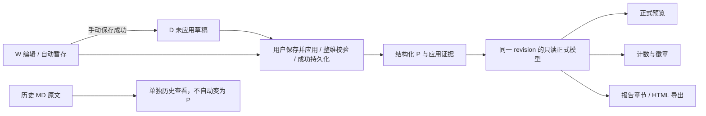

# BE-002｜企划设计平台：正式报告契约与历史兼容方案

日期：2026-11-11；只读核验基线：`94e1fd72c3518f09a6f7665cf8c1e074a2522217`，工作区 `.worktrees/codex`，分支 `codex/develop`。本轮只交付核验、契约与待评审方案，不修改业务源码。

统一依据：GD《企划设计平台｜全局产品范围与AI职责唯一基线》V1.0（原内部参考未随附）。已通过连接器读取标题、版本及正文；tab `t.0`。第四节规定：W 是编辑/自动暂存，D 是手动保存草稿，P 是整维校验后成功保存并应用的正式成果；报告与统计仅取结构化 P，MD 研究档案不能成为新正式正文。第七节规定导入权限、版本、重复和失败保护；本方案的接口/兼容实现仍需评审，不冒充基线已确认细节。

## 首要结论

**现状 FAIL：正式计数、维度预览和报告正文没有使用一个正式成果读取口径。** `current` 存在不等于用户已应用，`applied` 缺失不等于 `true`。新正式报告必须从经过验证的结构化 P 渲染；旧原文完整保留，不自动把旧 MD 转为 P。

## 读取链及源码证据

| 环节 | 现状读取/写入 | 证据（均为本分支源码） |
|---|---|---|
| 持久化读入 | GET /api/state、页面 __BOOT__ 取得 revision/state；前端操作内存 data | `modules/bg/server.py:667`、`:787`；`modules/bg/index.html:22` 起 |
| 编辑 W | `draft` 为工作内容，`autoDirty=true` 为未手动保存的修改；部分自动暂存失败仍保留内存 draft 供重试 | `index.html:315`、`:570`、`:606`；`dimension-assets/dim-multi-platform.js:87` |
| 保存 D | 追加/复用 `versions.kind=draft`，快照仍位于 draft；成功后 `autoDirty=false`，不改 current | `index.html:405` |
| 应用 P | 整维 workspaceValidation；写 current、applied=true、appliedAt，升级匹配 D 或追加 applied 版本，清 draft/autoDirty；持久化失败回滚 | `index.html:436`—`:460` |
| 服务端保存 | revision CAS；valid_state 校验 current/draft/versions；成功后同事务写 app_state 并递增 revision | `server.py:461`—`:608`、`:797`—`:818` |
| 维度正式预览 | 通常 selected 历史快照 → 工作模式 draft → current → seed；不以报告正文作为来源。历史预览是另一视角 | `index.html:306`、`:506`、`:568`、`:604`；`dim-multi-platform.js:27` |
| 完成计数 | count→hasAppliedDimension→`Boolean(current && applied!==false)`；概览徽章同口径 | `index.html:77`、`:80`、`:100` |
| 报告章节徽章 | done：有 item 时只判断 applied!==false，无 item 时判断旧 bodies.text 非空 | `index.html:77`、`:229` |
| 报告章节正文 | done 为真后直接读 `body(...).text`，不渲染 current；body 不存在会抛异常 | `index.html:229` |
| 单文件 HTML | 章节同样经 done 后读 bodies.text；封面却仍用 count | `index.html:280`—`:281` |
| 集成适配 | 适配器全局替换报告/导出正文条件为 body?.text?.trim，报告模板正文加可选读取；两处在无 MD 时不再崩溃，却仍没有结构化 P 正文 | `scripts/adapt_sources.py:48`—`:52` |

`bodies.text` 是旧正文编辑/导入链：`ensureBody`→`saveEditor`→`persist`，包含 revision/savedAt；研究周期的 `files`、`integrations` 与此又是不同存储。`saveEditor` 先改内存文本再异步保存，不能把内存有文本等同于服务端已提交的正式版本（`index.html:265`—`:267`）。

正式预览另有 `shell`→`render` 的“未应用”提示层（`index.html:86`、`:88`—`:96`）：hasAppliedDimension 为 false 时追加“暂无正式内容”，文字视图可单独展示历史原文。iframe 消息仍可能传 current/seed；本轮 VM 验证的是读取/消息数据，不把该值称为 P，也不声称做过实际像素遮挡验收。

概览的“应用时间”还会回退到非 draft 版本的 createdAt 或旧正文 savedAt（`index.html:100`），因此显示过日期也不能证明真实应用。目标模型仅对已确认 P 展示正式应用时间；原时间作为历史时间保留，不伪造 appliedAt。

### done() 与 hasAppliedDimension() 的差异

| 数据 | done | hasAppliedDimension / count | 含义 |
|---|---:|---:|---|
| 无 item，旧 MD 非空 | true | false / 0 | 报告可标完成且读旧文，概览计数却为 0 |
| 有 current，applied=false | false | false / 0 | seed/未应用，不是 P；即便有旧 MD，done 也不回退 MD |
| 有 current，applied=true | true | true / 1 | 现有代码认定已应用；仍需结构/版本/提交成功证据 |
| 有 current，applied 缺失/null/非 false | true | true / 1 | 宽松比较造成的旧兼容推定，不能证明正式应用 |
| item={} 或没有 current 且 applied 不为 false | true | false / 0 | 异常记录，两个函数继续不一致 |

源码保留的旧恢复函数会写 `{current,versions}` 而不写 applied（DIM-02/03/04 和多维恢复函数）；但当前确认恢复入口走 `workspaceRestoreVersion`，只恢复到 draft（`index.html:657`—`:658`）。旧函数存在不证明真实历史记录曾经走过该分支；初始示例版本也可能没有 kind。故“缺 applied”可能来自原始示例、旧发布、旧恢复或脏数据，不能直接解释为用户已正式确认。现有后端接受一部分无标记/无 kind 历史；版本 label 与时间也不能单独作为用户同意的充分证据。不得为了统一计数批量补 `applied=true`。本轮没有读取真实项目库来统计或改写这些记录。

## 提议的最小正式读取契约（待开发评审）



这是目标合同，尚未实现。现状的关键分叉是：showcases/current→hasAppliedDimension→计数，而 bodies.text→报告/导出；集成适配未把两条链统一。

建议增加一个只读 resolver / report view model，供正式预览、概览、报告封面、章节、导出共同使用。示意合同不等于已实现接口：

```json
{
  "projectId": "synthetic-project",
  "dimensionId": "DIM-03",
  "stateRevision": 1,
  "classification": "formal | none | legacy-structured-unconfirmed | legacy-md-only | invalid",
  "formal": {
    "schemaVersion": "dimension-specific",
    "versionId": "applied-version-id",
    "appliedAt": "timestamp",
    "snapshot": {}
  },
  "countAsFormal": false,
  "hasWorkingChanges": false,
  "hasManualDraft": false,
  "legacyOriginalAvailable": false,
  "diagnostics": []
}
```

规则：strict applied=true、合法且受支持的 current、可关联的成功应用版本/提交证据一致，才输出 formal；缺标记或证据不全保留为未确认历史，不因 current 存在升级。如何认定已明确 applied=true 但历史版本已被允许删除的记录，须单列兼容决策：**不要求“所有版本必须永远存在”来否定已证实的 P，但证据不足时不得造证据**。是否增加持久化的 formalVersionId/schemaVersion/appliedRevision，先由后端方案确认，不在前端自行写入。

报告模型一次绑定同一 stateRevision，按固定 12 维输出 chapters；封面 formalCount = count(chapter.formal)，同一份模型生成在线报告和 HTML。每维使用对应结构渲染器，保留字段语义、专业模块顺序、状态、图像/来源/证据关联；不直接把交互 iframe 的任意 DOM innerHTML 作为报告。历史预览有单独来源标记，不能影响正式口径。

导出需检查渲染能力和数据状态：不支持/损坏的结构给出明确诊断；不得借旧 MD 悄悄冒充 P。单文件资源策略（图片内嵌、外链、来源链接、体积上限）待确认；在这些策略未定前不宣称完整离线导出已验收。文本转义、URL 白名单和脚本禁用须作为合同安全门槛。

## 兼容决策表：目标显示规则与待确认项

下表是最小兼容建议；已确认的“只有 P 进入新正式报告”不可改写，其余交互/历史确认方式标明待确认。

| 场景 | 工作区 W / 草稿 D | 正式预览 | 项目正式计数 | 新正式报告章节 / HTML | 历史原文及待确认 |
|---|---|---|---:|---|---|
| 仅 W（自动暂存/dirty） | 展示可继续编辑 W；区分服务端已暂存与仅内存/失败 | 暂无正式成果，示例不得伪装成 P | 0 | 空章节 + 未应用 | 是否允许独立“工作区预览”待确认；必须明确非正式 |
| 仅 D（autoDirty=false 且手动草稿版本存在） | 草稿已保存，允许恢复/继续编辑 | 暂无正式成果 | 0 | 空章节 + 草稿未应用 | 单凭 autoDirty=false 不证明 D；须有对应手动草稿证据 |
| 已有 P 后继续编辑 W/D | 工作区显示新修改/草稿 | 始终显示上次成功 P | 1 | 渲染旧 P，不能读未应用修改 | 应用成功后整体替换为新 P；应用前不改变正式数 |
| P 与旧 MD 并存 | W/D 维持原规则 | 结构化 P | 1 | 只渲染 P；不能把不同版本的 MD 拼入同章 | 旧 MD 原文只读保留；历史入口位置/是否另提供旧格式导出待确认 |
| 仅旧 MD | 不自动导入为 W，更不自动生成 P | 新正式预览为空；可单独查看“历史原文，未确认为结构化正式成果” | 0（新正式口径） | 空章节 + 历史原文可查，不算正式完成 | 历史完成状态如何并列展示待业务确认，不删除旧统计依据 |
| current 存在但 applied 缺失 | 可先只读核对；不默认为 W 或 P | “历史结构化成果，应用状态待核对” | 0（建议保守口径） | 不进入新正式正文，可显示待核对提示 | 是否允许用户逐维校验后明确应用，及已知旧版本发布证据映射规则待确认；无自动批量迁移 |
| 保存 D 失败 / 自动暂存失败 | 保留本地修改并明确失败；不可声称保存成功 | 有 P 则维持 P；否则为空 | 旧值 | 不读取失败内容 | 重试/重载要处理并发冲突；用户决定前不丢 W |
| 应用失败（校验/400/409/网络/写入失败） | 保留未成功应用的 W/D，提示真实失败 | 有 P 则保持旧 P | 旧值 | 仍用旧 P 或空章节 | “服务端已提交但响应丢失”的不确定状态需先重读 revision 核对，不能简单认定失败或自动重复应用 |
| 异常旧数据（错结构、空 current、标记/版本矛盾） | 只读诊断，保护原始内容 | 明确无法判定/无法渲染，不静默 seed 代替 | 0 或保留待核对状态，不虚报正式 | 错误占位，阻止静默遗漏；是否允许部分导出待确认 | 不删除、不转换、不写回修复；结构 schema 和可修复动作先评审 |

历史标签/缺失标记处理、旧统计并列显示和部分导出策略为 **待确认**；本轮不得把建议变成代码中的强制迁移。

## 最小修改范围与前后端分工（只提案，未实施）

| 责任 | 最小范围 | 前置/边界 |
|---|---|---|
| Codex 后端/契约 | 校验器与发布语义审查，定义正式版本关联/幂等与 CAS；可先提出只读 report model，不立即迁移存储 | valid_state 目前未严格验证 applied 类型、状态与发布记录关系；若需后端调整，先提交方案 |
| Cursor 前端 | 用同一 resolver/model 驱动计数、徽章、正式预览、报告与导出；12 维结构渲染及失败/历史提示 | 不把当前值或旧 MD 直接认作 P；不自行修改 API 或替用户确认旧数据 |
| Codex 集成 | 核对原源码与适配产物差异，避免继续叠加“仅防崩溃”补丁；共用视图模型/固定 revision | 本轮不改 adapt_sources.py，不覆盖稳定 runtime |
| WorkBuddy / ChatGPT | 确认历史兼容决策、schema/报告字段完整性、Q66 入口及验收用例 | 仅确认/文档，不并行重构业务实现 |

建议先做无写回的分类/模型与两维渲染 POC，再评审发布证据的后端修正；不为修报告直接重构研究流程、不自动 MD→P、不合库、不读取真实资料做测试。

### 需要后端调整的最小提案（未实施，先评审）

只读内存核验已复现：DIM-03 与 DIM-04 均可仅将 applied 从 false 改为 true，保持 current/versions 不变而通过 `valid_state`。因此不能只把前端 done 换成 hasAppliedDimension 就宣称“成功发布”已被服务端证明。

建议优先在现有状态校验边界审查语义增量，避免为修报告新建另一套研究服务：

1. 对新建/发生变化的发布状态严格校验 applied 为 boolean；seed、W、D 不能被算作 P。已有缺标记历史保持原文/原对象并只读分类，不通过批量写 flag 获得兼容。
2. false→true、正式快照变更或 D 升级为 P，必须有对应的应用动作/版本、current 与该应用快照一致、整维 release 校验成功；release 校验不应只依赖可变显示文案 `label='保存并应用'`。
3. 保留合法的“匹配 D 升级 kind=applied”以及“删除历史版本不改变当前 P”；不能因已有版本允许删除，就将所有当前正式成果降格或凭空补造版本。
4. 明确新 P 的持久化关联证据（如 applicationId/schemaVersion/appliedRevision 或等价约束）。是否加字段/端点及对旧 PUT /api/state 的兼容由后端方案确认；本轮不写 schema、不迁移数据。
5. 沿用 revision CAS 与原子事务。为应用操作确定主体/项目/维度/输入摘要绑定的幂等或重读核对流程；响应丢失时先查询已提交 revision/应用标识，不凭浏览器失败提示重复写 P。
6. 把发布状态校验与 report model/resolver 的规则对齐，前端接收服务端已确认的版本视图。无权项目、错维度、坏结构、改 flag 无应用、重复、并发冲突、响应丢失均需合成数据负向验收。

以上调整涉及后端契约和现有保存客户端的协调发布，须先批准规则及回归范围。当前只提交方案，不触碰业务实现。

## 至少两种结构维度的验收合同（待修复后执行）

1. **DIM-03 v5 资质表**：合成多行包含资质名称、等级、有效期、是否具备、难度与壁垒。仅 W/D 时正式数 0；成功应用后正式数 1，维度正式预览、章节和导出同一行值。应用后继续把名称改成另一值但不应用，各正式输出仍显示原值。删必填/非法枚举应用失败，P、计数及历史不变；与旧 MD 并存不得读 MD。没有 applied 的结构记录只能待核对。
2. **DIM-04 v1.1 技术行＋分析＋证据引用**：合成技术行、overall/scope、先进点及 evidence 字典，证据 ID 有效关联。应用后章节/导出包含技术、分析与发布方/标题/链接/支撑；新草稿不污染正式输出。缺证据、URL 非白名单、关联悬空应失败且不改变 P；旧 topics 格式单独展示历史、不得静默转换成 rows。P 与冲突 MD 并存时所有正式输出只取 P。

共用负向：旧 MD-only、current-only、空 body、异常 item、重复应用、并发 revision、响应丢失，以及 source schema 不支持。当前实现能否满足及只读执行结果另见本轮证据记录；上面的目标验收不能因本轮只读核验就标成已通过。

日常交付遵循根目录 AGENTS.md；本契约作为待确认设计保留，旧核验脚本和详细结果已移至 [外部归档](RISKS.md)。
